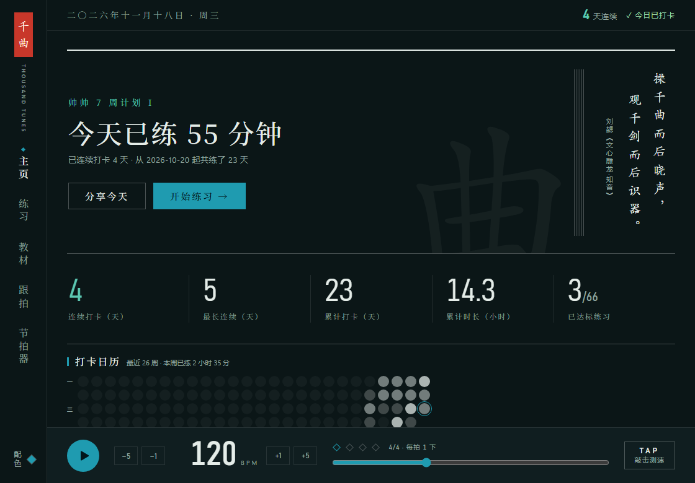
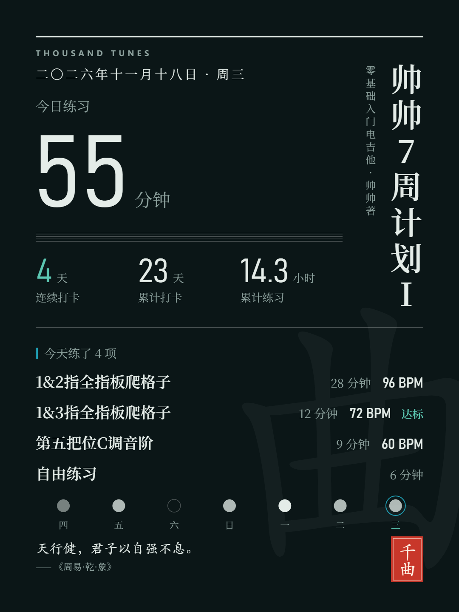
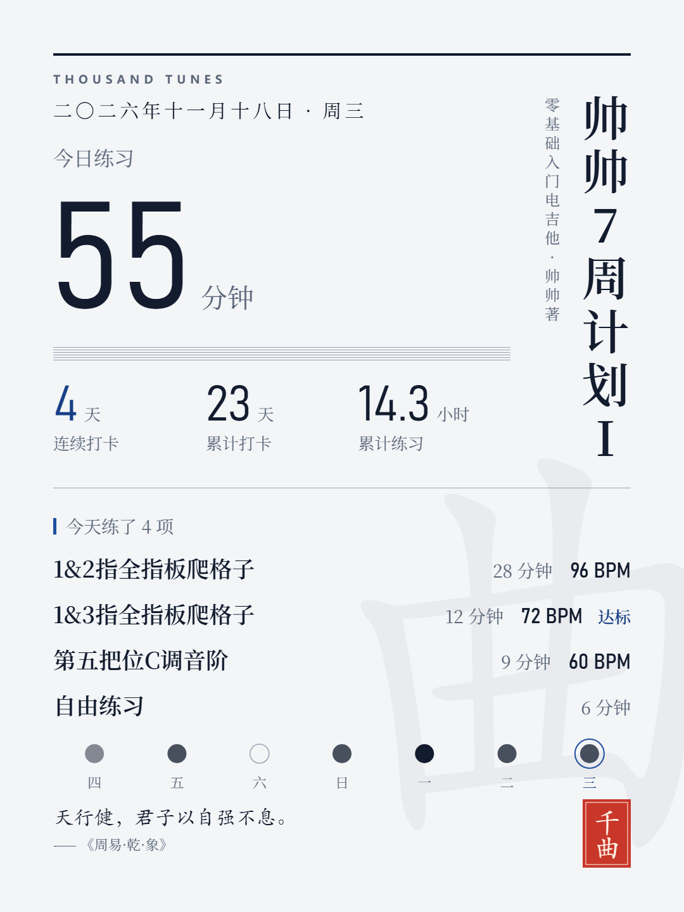
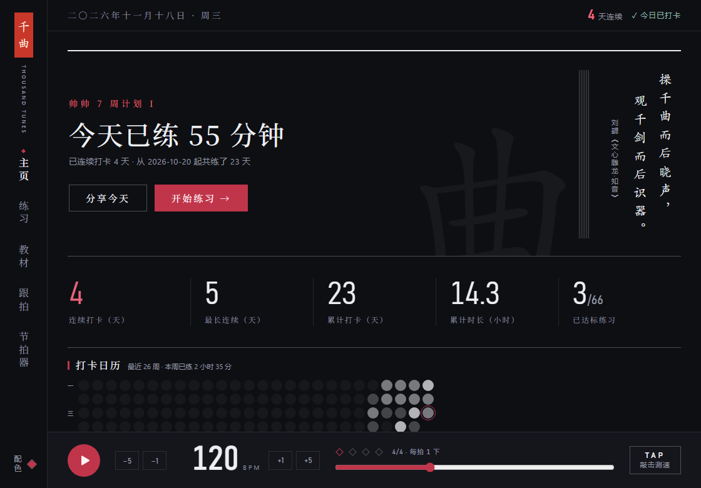
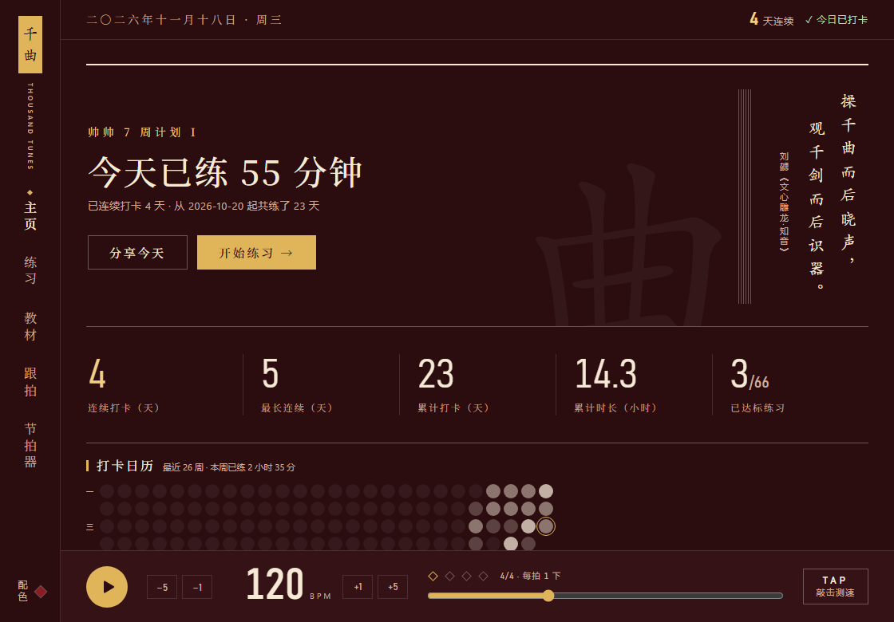
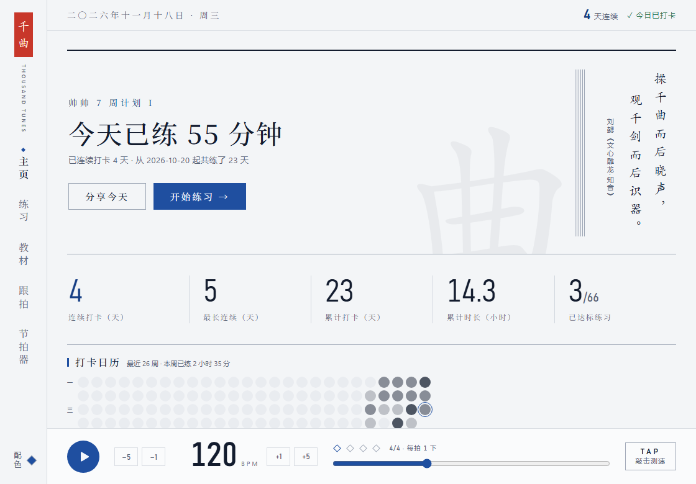
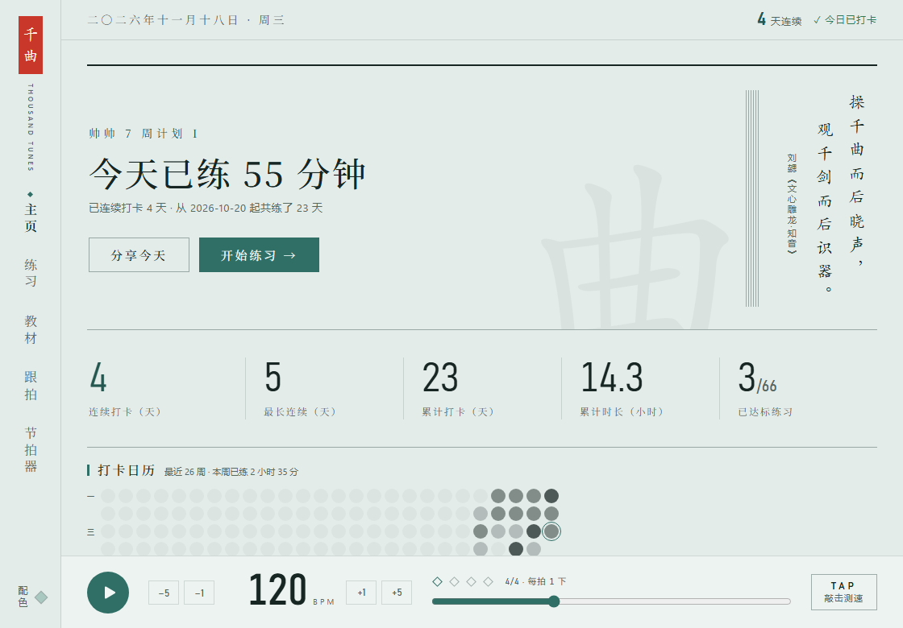

# 千曲 · Thousand Tunes

> 操千曲而后晓声，观千剑而后识器。
> —— 刘勰《文心雕龙·知音》

千曲是一个 Windows 上的练琴记录本，里面带一台节拍器。选一条练习，按下开始，节拍器响着的时间就记到这条练习今天的账上；每天练了什么、练了多久、练到多快，都留在本机的一个文件里。

它是 [kalaylienes/taktdock](https://github.com/kalaylienes/taktdock) 的个人练习版：节拍器的发声和计时沿用原项目，练习记录、教材、统计、分享图和整套界面是这个分支加的。



| 练习页 | 每日分享图 |
|---|---|
|  |  |

## 下载

到 [Releases](https://github.com/SasyaTitech/taktdock/releases) 下载最新的 `TaktDock-Practice-…-x64.exe`，直接运行，不用安装。

- 需要系统自带的 WebView2（Windows 11 已内置）。
- 程序没有代码签名，首次运行时 Windows 可能提示“未知发布者”。
- 同一页的 `.sha256` 文件可以用来核对下载是否完整。
- 每个发布都由 GitHub Actions 从对应标签的提交构建，不经过任何人的电脑。

## 功能

### 主页

打开软件先看到的是记录，而不是按钮：今天练了多久、连续打卡几天、最近 26 周的打卡日历、近 14 天的时长、教材进度和最近的记录。今日清单也在这里，点一条就直接去练。

### 练习

- 左边是今日清单，右边是当前这一条练习和节拍器。
- 选中一条练习后，节拍器开着的时间自动记到它今天的记录里。“本次”从每次按下开始算，“今日累计”是当天总和。
- 速度成绩由自己录入：点“记下当前速度”，或手动填写。练了半天又调慢了，再记一次就行。
- 没选练习时开节拍器，记为“自由练习”，同样计入当天总时长。
- 页面底部有一句关于练习的古文，点一下换一句。

### 教材

教材是目录，从里面挑出正在练的项目加入今日清单（可以整周加入），达标后自动移出。也可以在这里补记、修改以前某一天的记录，看每条练习的速度变化。

内置一份大纲：帅帅《零基础入门电吉他 7 周自学计划 1》，在软件里显示为“帅帅 7 周计划 I”。只收录标题、页码、每日时长和速度目标，不含教材正文和曲谱。

### 打卡

当天练满 1 分钟，或者记了成绩，就算打卡；没开节拍器练的那天可以手动打卡。

### 每日分享图

主页点“分享今天”，生成当天的练习卡片：教材名、时长、连续打卡、练了哪些项目和各自的成绩、最近七天，底下一句话和一方印。

- 竖版 3:4 或方形 1:1，颜色跟随当前配色。
- 落款的话可选古文（每句都注明出处）或练琴的玩笑话。
- 可以复制后直接粘贴，也可以保存到“图片\千曲”文件夹。

| 千里江山 | 青花 |
|---|---|
|  |  |

### 跟拍

把吉他接进声卡，跟着节拍一拍一拍地拨单音，软件显示每一下是早了还是晚了，并统计整体偏早偏晚和波动。

- 四拍预备；32、64、128 音一轮，或者不限长度手动停止。
- 做过回送校准后，早晚数值才扣除了设备延迟；没校准时只能参考，主要看波动。
- 只判断拨弦的时机，不判断音高。适合清晰的单音，不适合连奏和滑音。
- 输入的声音只在本机分析，不回放，也不保存录音。

### 节拍器

- 30 到 300 BPM，拍号、每拍细分、重音、三种音色、TAP 测速、输出设备。
- 在任何页面都能开始和停止，空格键也可以。
- 预设：把常用的速度和拍号存下来一键切换；可以开启全局快捷键，在别的程序里也能控制。
- 拍点按音频采样的位置排定，不依赖界面的定时器，所以窗口被遮住或系统变忙时节拍也不会晃。
- 音量 85% 以上会用限幅器把声音压得更响。

### 配色

左下角“配色”有十二套，名字取自它们的来处：

- 深色：千里江山（默认，石青石绿）、胭脂、玄青（藤黄配夜色）、宫墙（红墙金瓦）、玄朱、墨金、黛青、松烟。
- 浅色：青花、青瓷、素宣、月白。

色相依照传统，具体数值为了在屏幕上看得清做过调整。

| 胭脂 | 宫墙 |
|---|---|
|  |  |

| 青花 | 青瓷 |
|---|---|
|  |  |

## 数据

| 内容 | 位置 |
|---|---|
| 练习记录 | `%APPDATA%\TaktDock-Practice\journal.json` |
| 节拍器设置和预设 | `%APPDATA%\TaktDock-Practice\settings.json` |
| 保存的分享图 | “图片”文件夹下的 `千曲` |

备份 `journal.json` 就备份了全部练习记录。每条练习每天一条：累计秒数、当天成绩、是否达标、备注。播放时大约每 10 秒写入一次，所以播放中直接关掉窗口，最多丢失最后 10 秒。

## 添加教材

教材是 `src/books/` 下的 JSON 文件，放入新文件后重新构建，就会出现在“教材”页的下拉框里。

```json
{
  "id": "my-book",
  "title": "教材名称",
  "subtitle": "可选的副标题",
  "author": "可选的作者",
  "weeks": [
    { "title": "第一周", "exercises": [
      { "id": "W1-EX1", "title": "练习名称", "page": 5, "minutes": 10, "tempo": { "from": 50, "to": 100 }, "goal": "可选的补充要求" }
    ] }
  ]
}
```

- `tempo.to` 为 `null` 表示“练到原速”。
- `"unit": "percent"` 表示按原速的百分比记录。
- 没有 `tempo` 的练习（比如指板记忆）和按百分比记录的练习，成绩只能手动填写。
- `id` 一旦有了记录就不要再改，记录是靠它对上的。

## 从源码构建

需要 Node.js、Rust 和 Windows C++ Build Tools。

```sh
npm ci
npm run app:practice
```

生成的程序在 `src-tauri/target/release/taktdock.exe`。

```sh
npm test            # 界面测试（Playwright）
npm run test:rust   # 后端测试
```

发布：把 `src-tauri/tauri.practice.conf.json` 里的版本号改成新的，提交后推送同名标签（形如 `1.0.0-practice.9`，没有 `v` 前缀）。GitHub Actions 会跑完全部测试和检查，再构建并发布 exe 和校验文件。

## 声卡说明

节拍器通过 WASAPI 共享模式发声，和浏览器、播放器一样，不使用 ASIO。大多数 USB 声卡可以和别的声音同时播放。如果宿主软件用 ASIO 独占了声卡，就在“节拍器”页的输出设备里换一个出口，或者用宿主自己的节拍器。

## 和原项目的关系

- 原项目 TaktDock 是一个停靠在任务栏上的节拍器小组件。它的源码仍在这个仓库里，可以用 `npm run app:build` 构建；说明见[原项目的 README](https://github.com/kalaylienes/taktdock#readme)。
- 千曲用的是另一个构建（`app:practice`）：一个普通的可缩放窗口，不创建任务栏小组件。
- 原项目发布的安装包不包含这里的练习功能。

## 名字

“千曲”出自《文心雕龙·知音》：弹过一千首曲子才真懂得声音，看过一千把剑才识得兵器。启动时的名片、主页的题词和分享图上的印，用的都是这一句。

## 许可与致谢

- 以 GPL-3.0-or-later 发布，见 [LICENSE](LICENSE)。
- 节拍器、音频引擎和跟拍练习的基础来自 [kalaylienes/taktdock](https://github.com/kalaylienes/taktdock)。
- 内置教材大纲整理自帅帅的《零基础入门电吉他 7 周自学计划 1》，教材本身的版权归作者所有。
- 软件里引用的古文都注明了出处；练琴的玩笑话是为这个软件写的。
